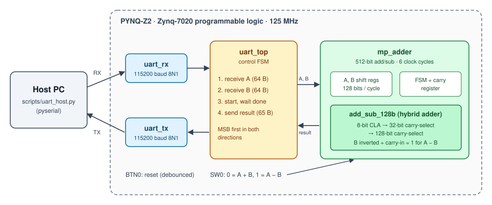
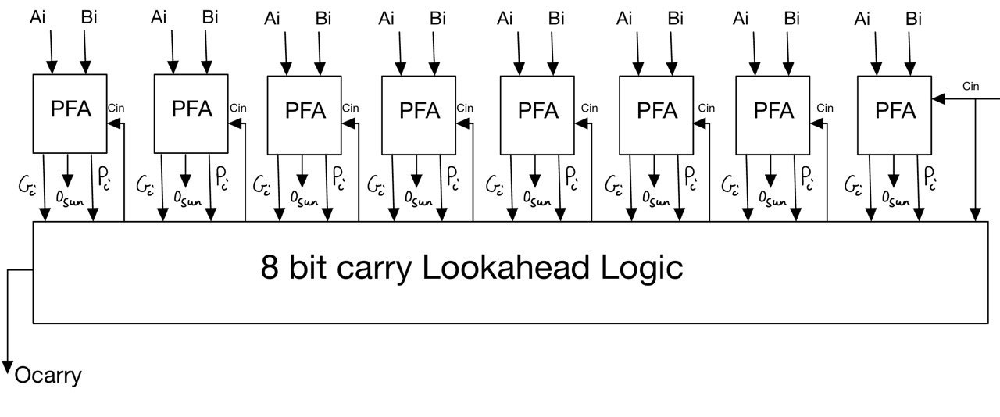
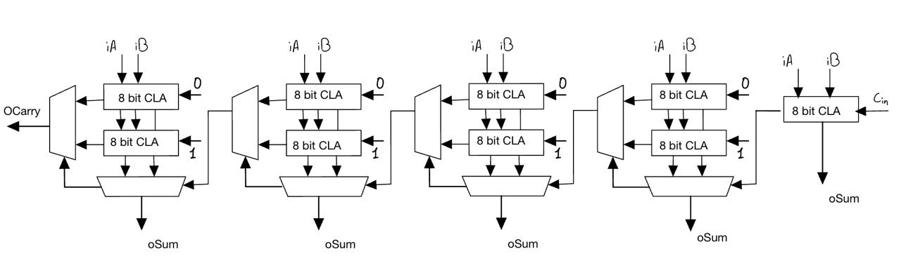
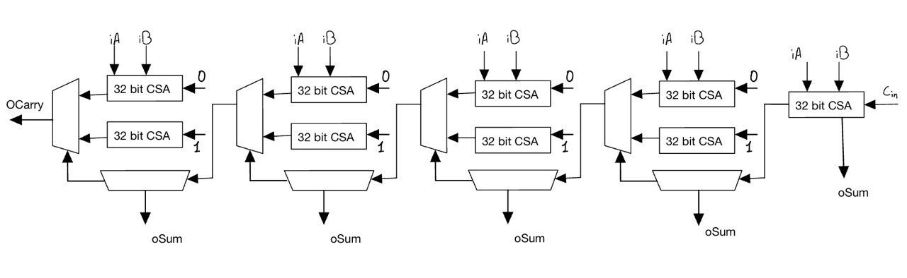

# 512-bit Multi-Precision Adder/Subtractor on FPGA

A hardware accelerator that adds and subtracts **512-bit integers** on a Xilinx
Zynq-7020 FPGA (PYNQ-Z2 board). Operands are sent from a PC over UART, the FPGA
computes the result in **6 clock cycles at 125 MHz**, and sends it back.

The core of the project is a **hybrid 128-bit adder** that combines
carry-lookahead and carry-select techniques. It was chosen after comparing ripple-carry,
carry-lookahead and carry-select architectures on timing and area.

Developed for the *Complex Digital Design* course (KU Leuven, Faculty of Engineering
Technology, Campus Group T, 2023–2024) by **Fadi Mardelli** and **Bolin Li**.

**Highlights**

- 512-bit addition and subtraction (two's complement) in 6 clock cycles, 5.7× fewer than the 34-cycle baseline
- Timing closed at 125 MHz on the full design after place and route (worst slack +0.199 ns)
- 12 adder architectures implemented in Verilog and compared
- Self-checking testbenches: every adder, the 512-bit datapath and the complete UART system

---

## System overview



| Block | Function |
|---|---|
| `uart_rx` / `uart_tx` | UART at 115200 baud, 8N1. The receiver double-registers its input and samples mid-bit. |
| `uart_top` | Control FSM. It receives operand A and operand B (64 bytes each), starts the adder and returns the 65-byte result. |
| `mp_adder` | Multi-precision adder/subtractor. It processes the 512-bit operands as four 128-bit words, least-significant first, and keeps the carry in a register between words. |
| `add_sub_128b` | 128-bit hybrid adder. For subtraction, operand B is inverted and the first carry-in is set to 1. |
| Block design | Clocking wizard (125 MHz) and a debounced reset button (`Debounce_Switch`) around `uart_top`. |

Latency of one 512-bit operation: 1 cycle to load the operands, 512 / 128 = 4 cycles to add,
and 1 cycle to signal completion, giving **6 cycles (48 ns at 125 MHz)**.

## Hybrid adder architecture

The 128-bit adder is built in three layers.

**1. 8-bit carry-lookahead adder (`CLA_8b`).** Eight partial full adders produce
propagate (P) and generate (G) signals. Every carry is computed directly from P, G and
the carry-in with flat equations, so no carry ripples inside the block.



**2. 32-bit carry-select adder (`CSA_32b_4x8`).** The upper 8-bit blocks are computed
twice, once assuming carry-in 0 and once assuming carry-in 1. Multiplexers then pick
the correct sum as soon as the real carry arrives.



**3. 128-bit carry-select adder (`CSA_128b_4x32`).** The same idea applied one level up,
with 32-bit blocks.



A 128-bit adder built from 32-bit *two-level* CLAs was also tried (`CSA_128b_4x32IterativeCla`).
It worked at 64 bits, but at 128 bits the long group-propagate/generate chain made it too
slow, so the flat 8-bit CLA was used as the leaf block instead.

## Results

All results are for the Zynq-7020 (`xc7z020clg400-1`) with a 125 MHz clock constraint (8 ns).

**Adder exploration.** The figures are post-synthesis with `mp_adder` as the top module,
as reported in the [project report](docs/report.pdf).

| Adder inside `mp_adder` | Adder width | Cycles per 512-bit op | Worst slack | Timing |
|---|---:|---:|---:|---|
| Ripple-carry (baseline from earlier labs) | 16 bit | 34 | +2.531 ns | met |
| Ripple-carry, widened | 32 bit | 18 | −1.484 ns | **failed** (9 endpoints) |
| Hybrid CLA / carry-select, add only | 128 bit | 6 | +1.004 ns | met |
| **Hybrid CLA / carry-select, add + subtract (final)** | **128 bit** | **6** | **+0.687 ns** | **met** |

Widening the ripple-carry adder to cut the cycle count breaks timing. The hybrid adder is
8× wider than the baseline (128 vs 16 bits), which cuts an operation from 34 to 6 cycles
while still meeting 125 MHz.

**Full design after place and route.** This covers UART, control, adder, clocking and
reset logic. Source: Vivado implementation reports.

| Metric | Value |
|---|---|
| Worst negative slack (setup) | +0.199 ns, all constraints met |
| Slice LUTs | 3,040 (5.7 % of 53,200) |
| Flip-flops | 3,272 (3.1 % of 106,400) |
| Total on-chip power (estimate) | 0.245 W |

After synthesis, `mp_adder` uses 1,855 LUTs and 1,584 flip-flops. The 128-bit hybrid
adder alone accounts for 827 of those LUTs.

## Verification

Three self-checking testbenches in `sim/` compare the hardware against a reference model:

| Testbench | What it checks |
|---|---|
| `tb_adders.v` | All 12 adder architectures. Each gets 2,000 vectors: corner cases (all zeros, all ones, a carry through every bit) plus random operands and carry-in. |
| `tb_mp_adder.v` | The 512-bit adder/subtractor: 408 random and corner-case operations in both modes. It also measures latency. |
| `tb_uart_top.v` | The complete system. A behavioural UART host sends operands and checks every returned byte, in both modes, including a carry that ripples through all 512 bits. |

Run them with [Icarus Verilog](https://steveicarus.github.io/iverilog/) (version 11 or later).
On Windows, use Git Bash or WSL:

```bash
./scripts/run_sim.sh
```

```text
=== tb_adders
ripple_carry_adder_Nb         32-bit  PASS
...
add_sub_128b                 128-bit  PASS
adders: ALL PASS
=== tb_mp_adder
mp_adder: 408 operations, latency 6 cycles, 0 errors -> PASS
=== tb_uart_top
uart_top: 8 transactions over UART, 0 errors -> PASS
```

The testbenches also run in the Vivado simulator. The rebuild script adds them to the project.

## Repository structure

```text
.
├── rtl/
│   ├── adders/        adder architectures (ripple, CLA, carry-select, final hybrid add_sub_128b)
│   ├── common/        2:1 multiplexers used by the carry-select stages
│   ├── core/          mp_adder: multi-precision adder/subtractor (FSM + datapath)
│   ├── uart/          UART receiver, transmitter and the top-level control FSM
│   └── third_party/   switch debouncer (nandland.com)
├── sim/               self-checking testbenches
├── constraints/       PYNQ-Z2 pin and clock constraints
├── vivado/            block design (clocking wizard + debouncer + uart_top) as Tcl
├── scripts/
│   ├── create_project.tcl   recreates the Vivado project (and optionally the bitstream)
│   ├── run_sim.sh           runs all testbenches with Icarus Verilog
│   └── uart_host.py         sends operands from a PC and checks the FPGA's answers
├── prebuilt/          bitstream (.bit) and hardware handoff (.hwh) of the final design
└── docs/
    ├── report.pdf     project report
    └── figures/       diagrams used in this README
```

## Build and run on the PYNQ-Z2

**Requirements:** Vivado 2020.1 (with the PYNQ-Z2 board files), a PYNQ-Z2 board, a
3.3 V USB-UART adapter, and Python 3 with `pyserial`.

1. **Recreate the project.** Run this from the repository root:
   ```bash
   vivado -mode batch -source scripts/create_project.tcl -tclargs build
   ```
   This creates the project in `build/vivado/` and generates the bitstream. Leave out
   `-tclargs build` to only create the project and open it in the GUI. If you'd rather not
   build anything, the ready-made bitstream is in `prebuilt/`.
2. **Program the board** with the Vivado Hardware Manager.
3. **Connect the UART adapter** to the Raspberry Pi header signals named in the PYNQ-Z2
   schematic:
   - adapter TX → `RPIO_20` (FPGA RX, pin A20)
   - adapter RX → `RPIO_26` (FPGA TX, pin W9)
   - GND → GND
4. **Select the operation** with switch SW0 (0 = A + B, 1 = A − B). BTN0 resets the design.
5. **Run the host script:**
   ```bash
   pip install pyserial
   python scripts/uart_host.py --port COM5 --mode add --count 10
   ```

The block-design script checks for Vivado 2020.1. To try a newer version, change
`scripts_vivado_version` at the top of `vivado/block_design_1.tcl`.

## Authors and credits

- **Fadi Mardelli** and **Bolin Li**: adder architectures, multi-precision adder/subtractor,
  integration, timing analysis and the [project report](docs/report.pdf).
- The course provided the starting skeletons for the multi-precision adder FSM, the
  UART modules and the UART top level. These were extended as part of the project.
- `rtl/third_party/Debounce_Switch.v` is from [nandland.com](https://nandland.com).
- The self-checking testbenches, simulation script and host script were added when the
  project was prepared for publication.
